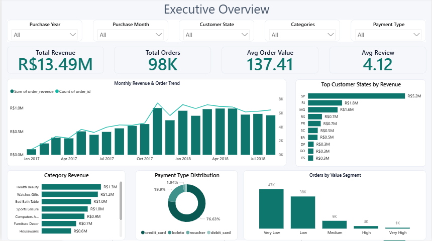
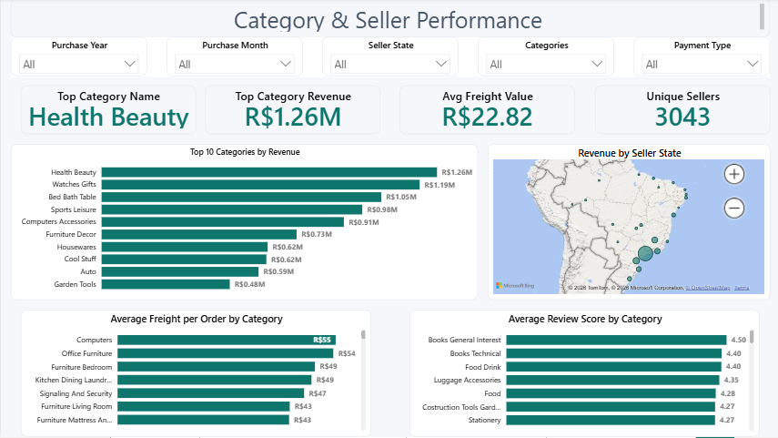
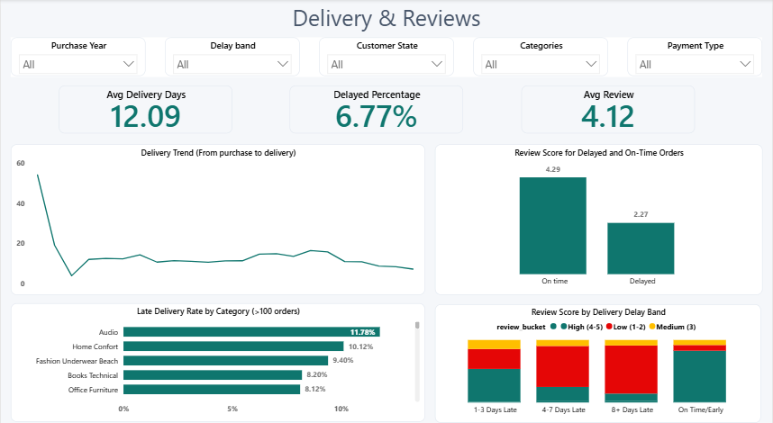
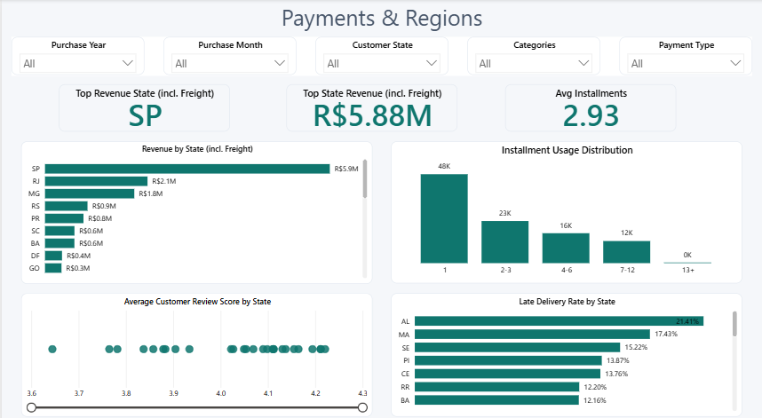

# Brazilian E-Commerce Analytics: Python Data Prep + Power BI Dashboard

An end-to-end analytics project on the Olist Brazilian E-Commerce dataset. Eight raw relational tables are cleaned and merged into one order-level dataset with Python (pandas), then explored in a 4-page interactive Power BI dashboard covering revenue, sellers, delivery performance, reviews and payments.

---

## Dashboard Preview

| Overview | Category & Seller Performance |
|---|---|
|  |  |

| Delivery & Reviews | Payments & Regions |
|---|---|
|  |  |

---

## Business Questions

- How are revenue and order volume trending over time?
- Which product categories and sellers drive the most revenue, and which have high freight costs or weak reviews?
- How often are orders delivered late, and where (state, category)?
- Does late delivery hurt customer review scores?
- How do customers pay (payment type, installments), and how does that vary by order value and region?

---

## Key Insights

> Replace these with your real numbers from the dashboard.

- **6.77%** of delivered orders arrived after the estimated date; late orders averaged a review score of **2.27** vs **4.29** for on-time orders.
- **Health Beauty** generated the highest revenue, while **Computers** had the highest freight cost for greater than 100 orders.
- **São Paulo** accounted for **38.28%** of total revenue; **Alagoas** had the highest late-delivery rate.
- **Credit card** made up **76.63%** of orders; most orders used **1** installment(s).
- Revenue peaked in **November 2017**.

---

## Data

- **Source:** [Brazilian E-Commerce Public Dataset by Olist (Kaggle)](https://www.kaggle.com/datasets/olistbr/brazilian-ecommerce), licensed CC BY-NC-SA 4.0.
- **Raw tables used (8):** orders, customers, order items, payments, reviews, products, sellers, category name translation.
- **Raw and processed data are not included in this repo.** Download the raw files from Kaggle and follow the steps in *How to Reproduce*.

---

## Data Preparation (`Notebook/data_preparation.ipynb`)

1. **Cleaning:** removed duplicates, converted date columns to datetime, standardized city/state text, handled missing category names.
2. **Filtering:** excluded `canceled` and `unavailable` orders.
3. **Translation:** mapped Portuguese product categories to English.
4. **Aggregation to one row per order:**
   - Payments: total value, average/max installments, number of payment types, main payment type
   - Reviews: average score, review count, latest review date
   - Items: item value, freight, item count, unique products/sellers, main category, main seller
5. **Master dataset:** merged everything on `order_id` / `customer_id` (~98K rows, 44 columns, no duplicate orders).
6. **Feature engineering:**
   - Time: purchase year, month, year-month, day name
   - Delivery: delivery days, delay days, `is_delayed`, `is_delivered`
   - Revenue: order revenue, total cost to customer (items + freight)
   - Segments: `review_bucket`, `installment_bucket`, `order_value_segment`, `delay_band`
7. **Validation:** checked shape, null percentages and duplicate order IDs, then exported `Master_ecommerce.csv`.

---

## Power BI Dashboard (`Dashboard/E-Com_Dashboard.pbix`)

| Page | What it shows |
|---|---|
| **Overview** | Monthly revenue and order trend, payment type split, order value segments, top categories and states |
| **Category & Seller Performance** | Top 10 categories by revenue, revenue by seller state, average freight and review score by category |
| **Delivery & Reviews** | Late delivery rate, delivery trend, late rate by category, review score by delay band |
| **Payments & Regions** | Revenue by state, installment usage, review score and late delivery rate by state |

Every page has slicers for year, month, state and category.

---

## Tools

Python (pandas, NumPy) · Jupyter Notebook · Power BI (DAX)

---

## How to Reproduce

1. Download the Olist dataset from Kaggle and place the CSV files in a `Raw_data/` folder at the project root.
2. Create an empty `Final_data/` folder at the project root.
3. Run `Notebook/data_preparation.ipynb`. It writes `Final_data/Master_ecommerce.csv`.
4. Open `Dashboard/E-Com_Dashboard.pbix` in Power BI Desktop and point the data source to the generated CSV.

---

## Repository Structure

```
├── Dashboard/E-Com_Dashboard.pbix
├── Images/            # dashboard screenshots
├── Notebook/data_preparation.ipynb
├── .gitignore
└── README.md
```

---

## Author

**Tanmay Nitin Kubal** · [LinkedIn](https://www.linkedin.com/in/tanmay-kubal-b42518256) · [tanmay.kubal03@gmail.com]

*Dataset credit: Olist, via Kaggle.*